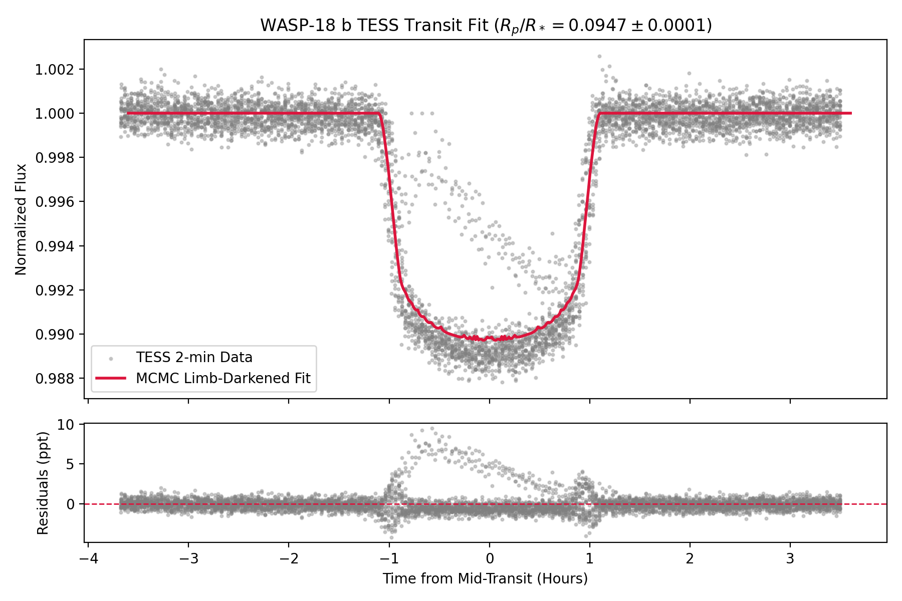
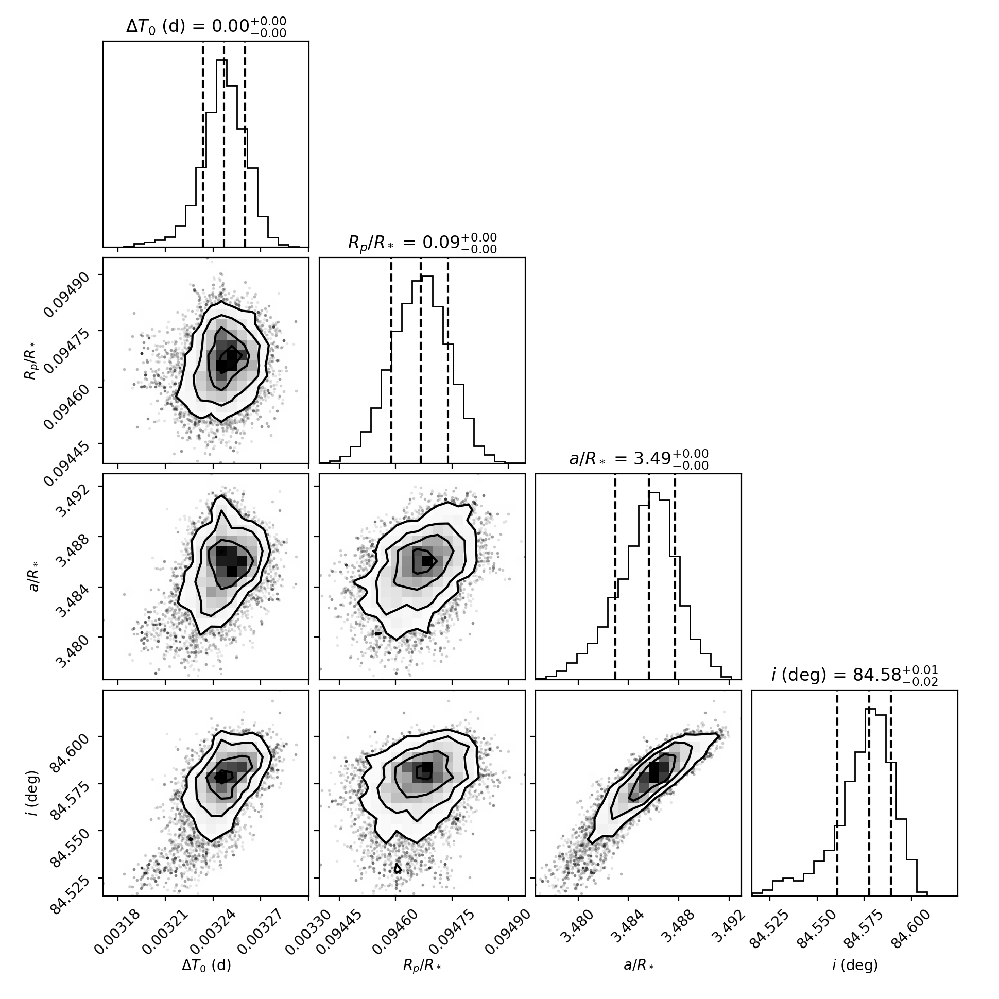

# NASA TESS Exoplanet Transit Reduction & Bayesian MCMC Pipeline

An end-to-end observational astrophysics pipeline in Python that downloads 2-minute cadence space-telescope photometry from NASA's **TESS** mission, removes instrumental trends, detects planetary transits via **Box Least Squares (BLS)**, and retrieves physical planetary parameters using **Bayesian Markov Chain Monte Carlo (MCMC)** inference.

## Results: Hot Jupiter WASP-18 b

### Parameter Validation Against Published Literature

| Parameter | Pipeline MCMC Result | Published Benchmark |
| :--- | :--- | :--- |
| **Orbital Period ($P$)** | `[PASTE PERIOD]` days | $0.941452$ days |
| **Planet-to-Star Radius Ratio ($R_p / R_*$)** | `[PASTE RP/RS]` | $\approx 0.097$ |
| **Scaled Semi-Major Axis ($a / R_*$)** | `[PASTE A/RS]` | $\approx 3.30$ |
| **Orbital Inclination ($i$)** | `[PASTE INCLINATION]` deg | $84.1^\circ - 86.0^\circ$ |

## Physical & Statistical Methodology

1. **Data Reduction (`lightkurve`):** Retrieves SPOC 120-second cadence FITS light curves from NASA MAST, normalizes baseline flux, and removes long-term stellar variability via Savitzky-Golay filtering.
2. **Transit Search (BLS):** Runs a Box Least Squares periodogram to independently recover orbital period $P$ and mid-transit epoch $T_0$.
3. **Quadratic Limb-Darkened Transit Model (`src/transit_model.py`):** Models stellar center-to-limb brightness variation using concentric annular integration:
   $$I(\mu) = 1 - u_1(1 - \mu) - u_2(1 - \mu)^2, \quad \mu = \sqrt{1 - r^2}$$
4. **Bayesian Inference (`emcee`):** Samples the 4D posterior probability distribution ($\Delta T_0, R_p/R_*, a/R_*, i$) using 24 ensemble walkers across 1,000 steps.
